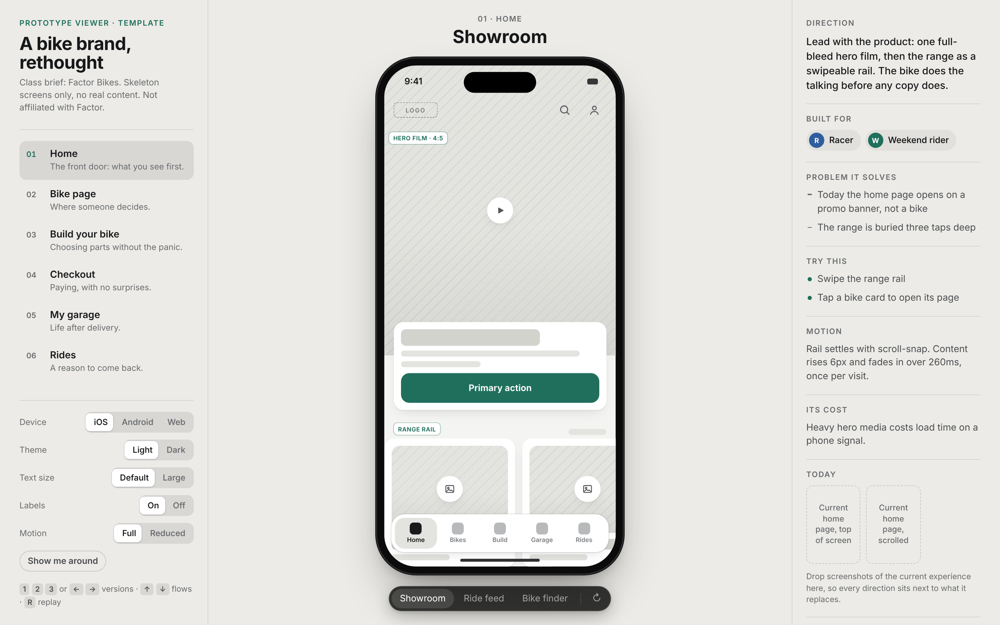
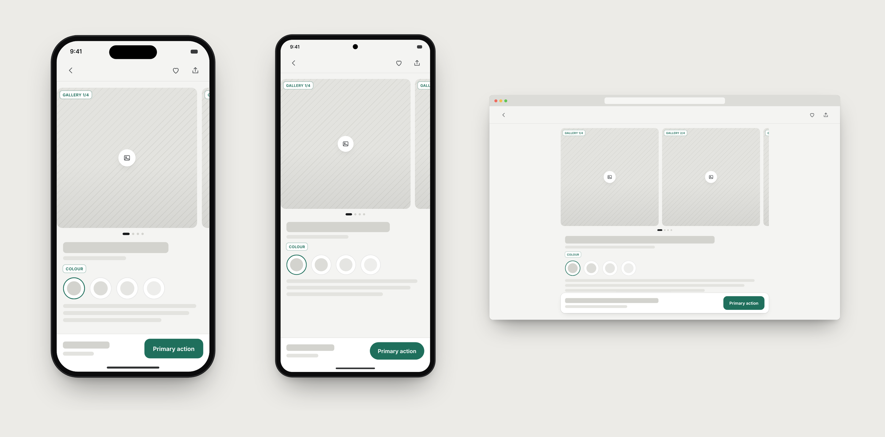
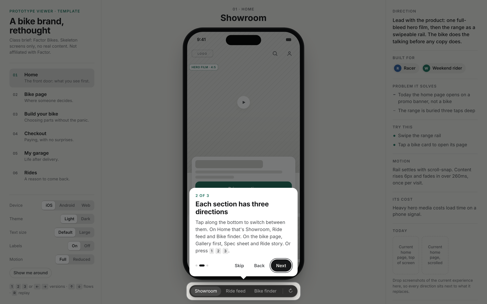

# Prototype Viewer

A single HTML file for presenting design directions. It holds a clickable prototype in a device frame, three directions per flow, and the reasoning behind each one, in a link anyone can open.



There is no install, no login and no Figma seat needed. Open the file, or host it anywhere, and the person on the other end gets:

- **Flows on the left.** Each flow is a part of the product: home, product page, checkout and so on.
- **A device in the centre.** iOS, Android or a browser window, running a clickable prototype.
- **Directions underneath.** Three ways to solve each flow, switched with one tap or the `1` `2` `3` keys.
- **The why on the right.** For each direction: what it explores, who it's for, the problem it solves, what to try, how it moves and what it costs.
- **A three-step tour** the first time someone opens it.

This repo ships a **skeleton version**: grey wireframes, a dashed logo placeholder and example rationale, based on a class brief for a premium bike brand. Use it to teach the format, or as a starting point for a real client.

## iOS, Android and web



The Device switch moves the same screens between three frames. Each frame follows its platform's conventions:

| | Frame | Screen | Navigation |
|---|---|---|---|
| **iOS** | iPhone, Dynamic Island | 390 × 844 | Floating bottom tab bar, home indicator |
| **Android** | Pixel-style, punch-hole camera | 412 × 915 | Material 3 navigation bar with pill indicator, gesture handle |
| **Web** | Browser window | 1280 × 780 | Top navigation, centred content column, dialogs instead of sheets |

## The tour



The tour shows once per browser. "Show me around" in the left panel replays it, and adding `?tour=1` to the URL forces it.

## Quick start

1. Download [`dist/prototype-viewer.html`](dist/prototype-viewer.html) and open it in a browser. That's the whole thing.
2. To change it, edit the files in `template/src/`, then rebuild:

```bash
cd template
python3 build.py      # writes ../dist/prototype-viewer.html
```

The build only inlines files, so you need Python 3 and nothing else.

## How it's put together

```
template/
  build.py            inlines everything into one HTML file
  src/
    index.html        page skeleton
    shell.css/js      viewer: flows, device frames, controls, rationale panel
    picker.css        version switcher under the device
    tour.js           first-visit onboarding
    kit.css/js        components inside the device, with iOS / Android / web adaptations
    screens/
      screens.js      every flow and its three directions
dist/
  prototype-viewer.html
skill/
  brand-prototype-viewer/SKILL.md
docs/                 images for this README
```

### Add or change a flow

Flows are listed in `shell.js`:

```js
const FLOWS = [
  { id: "home", title: "Home", sum: "The front door: what you see first.", today: ["Current home page"] },
  …
];
```

Each flow registers three directions in `screens.js`:

```js
Proto.versions("home", [{
  name: "Showroom",
  axis: "Lead with the product: one full-bleed hero, then the range.",
  personas: ["racer", "weekend"],
  fixes: ["Today the home page opens on a promo banner"],
  tryThis: ["Swipe the range rail"],
  motion: "Rail settles with scroll-snap; content fades in over 260ms.",
  tradeoff: "Heavy hero media costs load time.",
  render(root, ctx) {
    root.innerHTML = `…`;          // build the screen with Kit helpers
    return () => {};               // optional cleanup
  },
}, …]);
```

`ctx.go("bike", 0)` jumps to another flow, and `ctx.toast("Saved")` shows a message. Write each screen once: the platform differences live in CSS.

### Controls

| Control | Options | Remembered |
|---|---|---|
| Device | iOS · Android · Web | yes, and in the URL |
| Theme | Light · Dark | yes |
| Text size | Default · Large | yes |
| Labels | On · Off, the wireframe block names | yes |
| Motion | Full · Reduced, which follows the system setting | yes |

Keyboard: `1` `2` `3` or `←` `→` for directions, `↑` `↓` for flows, `R` replays the screen.

## The Claude skill

`skill/brand-prototype-viewer/SKILL.md` teaches Claude to build a viewer like this for a real client. Before designing anything, it asks for a **Figma link or brand assets** (logo, colours, fonts, screenshots), so every viewer is built on that client's brand and not a generic style. It also asks which platform to use: iOS, Android, web or all three.

To use it, add the `brand-prototype-viewer` folder to your Claude skills, then ask for a prototype viewer for your client.

## Notes

- **Fonts.** The skeleton uses Inter from Google Fonts and falls back to the system font when offline.
- **Storage.** Preferences are kept in `localStorage`. If storage is blocked, the page still works, with the defaults.
- **The class brief.** It uses Factor Bikes as the subject. This project isn't affiliated with Factor, and there's no Factor content, logo or imagery in it.
- **Credit.** The version switcher's styling is adapted from Emil Kowalski's prototype picker.

## Licence

MIT. See [LICENSE](LICENSE).
